#  User Guide

This guide explains how to use Desktop CEA. It will be updated as the application changes. Please feel free to report bugs or glitches.

## Getting Started

- Download the Windows executable (`.exe`) for Desktop CEA.
- Keep the executable in a dedicated folder to make the application and its output files easier to find. Exports are saved in a `Results (Desktop_CEA)` subfolder of the application's working directory.
- Double-click the executable to launch the application.

Click any screenshot below to view it at full size.

## Running a Basic Calculation

### 1. Launch the application

Choose the **Monopropellant** or **Bipropellant** tab. The example below uses the **Bipropellant** tab.

<a href="../Images/screenshot_2_opening.png">
  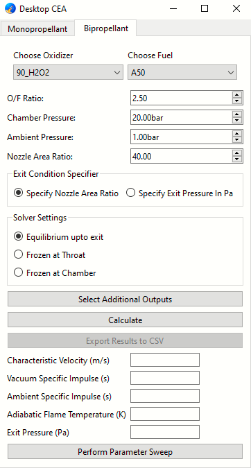
</a>

*The main window, ready for your inputs*

### 2. Choose your propellant(s)

Select an oxidizer and fuel from the drop-down menus for a bipropellant calculation, or a single propellant for a monopropellant calculation.

<a href="../Images/screenshot_4_select_prop.png">
  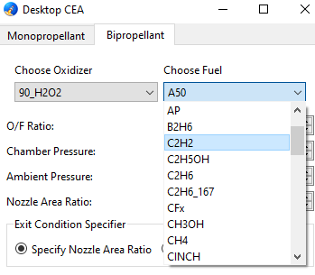
</a>

*Drop-down menu showing different fuel options*

### 3. Enter input conditions

Enter the O/F (oxidizer-to-fuel mass) ratio for a bipropellant calculation, chamber pressure, and ambient pressure. Chamber and ambient pressures are entered in **bar**. Choose either a nozzle area ratio or a nozzle exit pressure in **Pa**.

<a href="../Images/screenshot_5_inputs.png">
  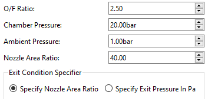
</a>

*Enter input conditions in the corresponding boxes and choose exit conditions (nozzle area ratio or exit pressure)*

### 4. Calculate the results

Click **Calculate**. The results will appear below the button.

<a href="../Images/screenshot_3_basic_calc.png">
  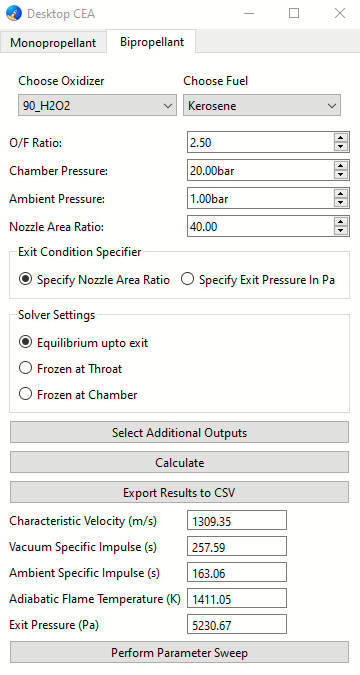
</a>

*Results for hydrogen peroxide (90% concentration) and kerosene*

### 5. Save results

Click **Export Results to CSV** and enter a filename without the `.csv` extension; the application adds it automatically. Results are saved in the `Results (Desktop_CEA)` subfolder of the application's working directory.

<a href="../Images/screenshot_3_csv_basic.png">
  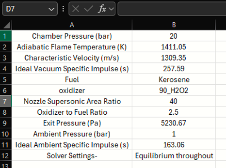
</a>

*Saved CSV results opened in Microsoft Excel*

**Note:** Each export contains the most recent calculation. Export a result before running another calculation if you want to keep it. Use a different filename for each export to avoid overwriting an existing file.

## Additional Features

### 1. Select solver mode

Choose a solver mode above the **Select Additional Outputs** button.

*Choose equilibrium expansion or freeze the gas composition at the throat or chamber.*

- **Equilibrium upto exit:** Assumes chemical equilibrium throughout the chamber, nozzle throat, and nozzle exit.
- **Frozen at Throat:** Uses equilibrium composition up to the throat, then holds that composition fixed during expansion to the exit.
- **Frozen at Chamber:** Holds the combustion-chamber composition fixed during expansion through the nozzle.

Here, *frozen* refers to chemical composition; temperature and pressure still change during expansion. See the [RocketCEA documentation](https://rocketcea.readthedocs.io/en/stable/std_examples.html#frozen-performance) for more on frozen-composition calculations.

### 2. Select additional outputs

Use **Select Additional Outputs** to choose properties such as chamber enthalpy, throat gas temperature, or exit Mach number. Select the properties you need and click **OK** to open the **Displaying Additional Outputs** dialog.

The selected properties are included when you calculate results and export them with **Export Results to CSV**.

<a href="../Images/screenshot_7_solver_additional_outputs.png">
  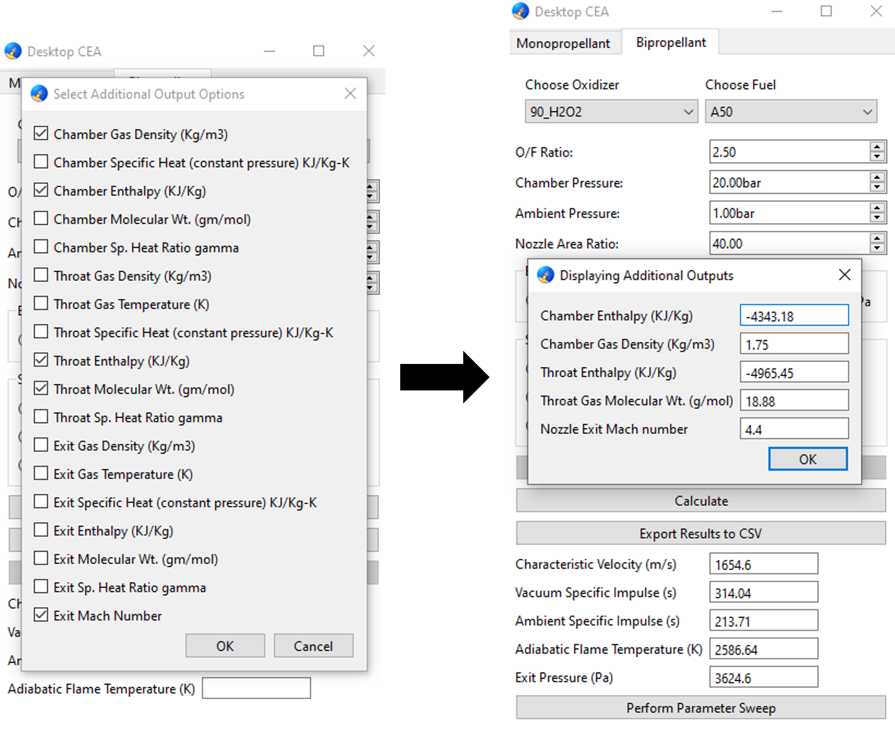
</a>

*Choose additional outputs (left) and view their calculated values (right).*

### 3. Parameter sweep

A parameter sweep calculates results at evenly spaced points across a range of O/F ratios, chamber pressures, or nozzle area ratios. O/F sweeps are available for bipropellants; chamber-pressure and nozzle-area-ratio sweeps are available for both propellant types.

The example below sweeps the O/F ratio for hydrogen peroxide (90% concentration) and kerosene.

#### a. Set your input conditions

In the **Bipropellant** tab, select the propellants and set these conditions:

- **Chamber pressure:** 10 bar.
- **Ambient pressure:** 1 bar.
- **Nozzle area ratio:** 50 (choose the nozzle-area-ratio input option).
- **Solver mode:** Equilibrium upto exit.

The O/F value in the main window is replaced by the sweep values. Sweeps use the nozzle area ratio rather than a specified exit pressure.

<a href="../Images/screenshot_9_input_sweep.png">
  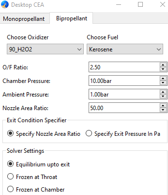
</a>

*Set the fixed input conditions before opening the sweep dialog.*

#### b. Open the parameter sweep dialog

Click **Perform Parameter Sweep** at the bottom of the main window.

<a href="../Images/screenshot_8_sweep.png">
  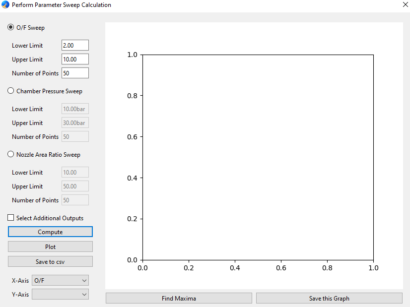
</a>

*Choose the parameter you want to sweep.*

#### c. Set the sweep range and compute results

Select **O/F Sweep** and enter:

- **Lower Limit:** 2.
- **Upper Limit:** 10.
- **Number of Points:** 50.

To include extra properties, check **Select Additional Outputs** and choose from the list that appears. For this example, select **Exit Gas Temperature (K)**. Sweep outputs are selected separately from the additional outputs in the main window.

<a href="../Images/screenshot_10_output_sweeps.png">
  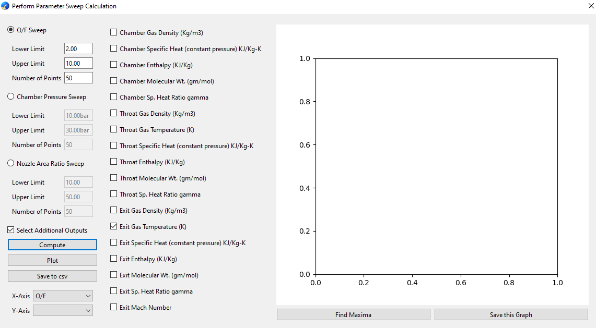
</a>

*Set the sweep range and select any additional outputs before computing.*

Click **Compute**. Once the calculation finishes, the results are available to plot or save. If you change the inputs or selected outputs, click **Compute** again to update the results.

#### d. Plot the results

After computing, the **Y-Axis** drop-down lists the default outputs and any additional outputs you selected. The **X-Axis** corresponds to the parameter being swept.

<a href="../Images/screenshot_12_plot_options.png">
  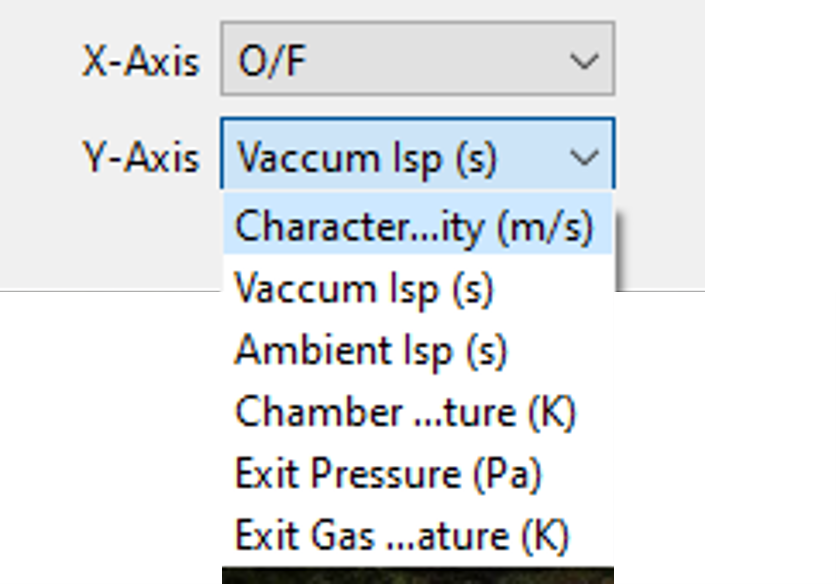
</a>

*Choose an output to plot against the O/F ratio.*

Select vacuum specific impulse (**Vaccum Isp (s)** in the drop-down), then click **Plot**.

<a href="../Images/screenshot_11_output_plot.png">
  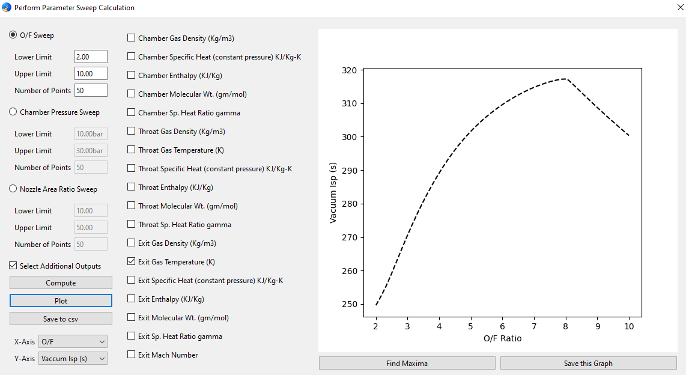
</a>

*Vacuum specific impulse (s) as a function of O/F ratio.*

#### e. Find the peak

Click **Find Maxima** to mark and annotate the peak of the selected output. In this example, the highest sampled vacuum specific impulse is **317.26 s** at an **O/F ratio of 8.04**.

<a href="../Images/screenshot_13_peak.png">
  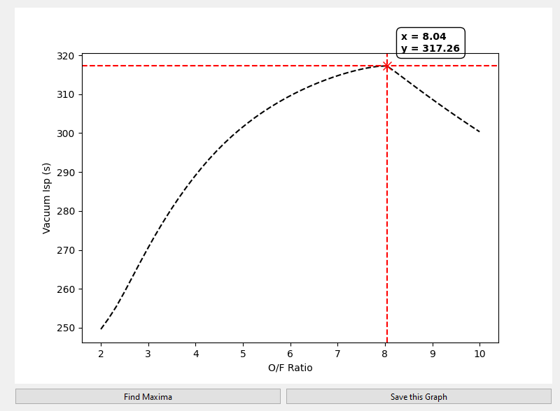
</a>

*The peak identified in the computed sweep.*

**Note:** The peak is found from the sampled points; it is not a separate optimization calculation. To refine the O/F estimate, narrow the sweep range around the peak and increase the number of points. A curve that only increases, only decreases, or remains constant will display **Maxima not found**, even though it has a highest sampled value.

#### f. Save the graph and sweep data

- **Save this Graph:** Enter a filename such as `of_sweep.png` to save the current graph as a PNG image.
- **Save to csv:** Enter a filename such as `of_sweep` to save the most recently computed sweep, including additional outputs. The application adds the `.csv` extension if needed.

Both files are saved in the `Results (Desktop_CEA)` subfolder of the application's working directory. Save the graph after plotting and adding any peak annotation you want to keep.

**Note:** Save sweep data before computing another sweep if you want to keep it. Use a different filename for each export to avoid overwriting an existing file.
