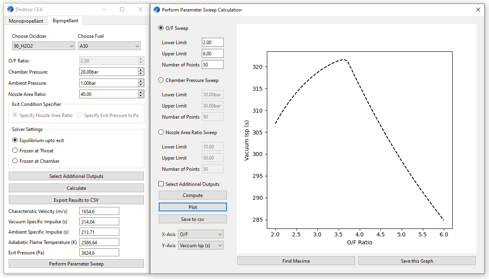

#  Desktop CEA

Desktop CEA is a graphical interface for rocket chemical equilibrium calculations, powered by RocketCEA.

<a href="Images/screenshot_1.png">
  
</a>

## Download for Windows

* Download the Windows executable from the [latest release](
https://github.com/NathRepo19/Desktop-CEA/releases/latest).
* Under Assets, select the `.exe` file and double-click it to launch Desktop CEA.
* Standalone application for Windows 11 (64-bit). No Python installation required.
* [User guide](docs/guide.md)

## Features

* Calculate specific impulse, characteristic velocity, flame temperature and other parameters as a function of propellant type, chamber pressure, ambient pressure and exit conditions
* Both monopropellant and bipropellant calculations are available
* Perform a parameter sweep to calculate propulsion parameters over a range of O/F (oxidizer to fuel mass ratio), chamber pressure or nozzle exit area ratio
* Plot results in the GUI and find the maximum value within a parameter sweep
* Export individual calculations and parameter sweeps as CSV files, and save plots as PNG images

## Build and Run from Source

```bash
python main.py
```

## Dependencies

Running Desktop CEA from source requires Python and these libraries:

- **PySide6** - Qt based graphical user interface
- **RocketCEA** - rocket chemical equilibrium and propulsion calculations
- **NumPy** - numerical arrays and parameter sweeps
- **Matplotlib** - plotting and embedding charts in GUI

The project also uses Python's built-in modules, including `pathlib`, `dataclasses`, `csv` and `copy`. These require no separate installation.

**The Windows executable bundles its dependencies and does not require a separate Python installation.**
